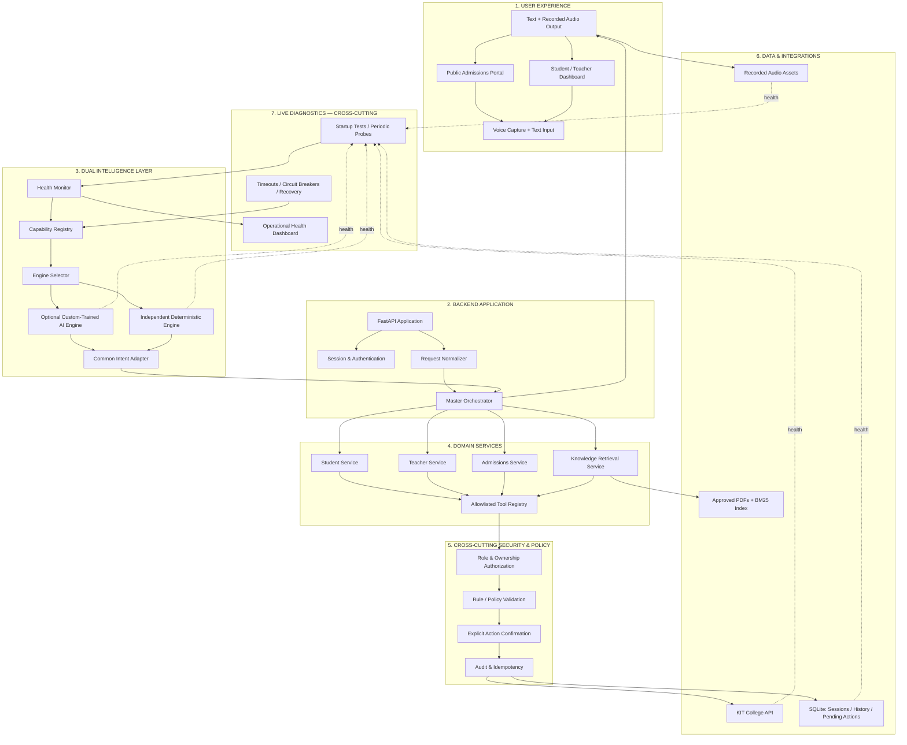

# KIT VOX

## AI-Optional, Fault-Tolerant Hybrid Voice Assistant

### Detailed System Architecture, Engineering Decisions, Recommended Skills, and Implementation Guide

**Document purpose:** Define a practical architecture for the KIT VOX
hackathon application. This document is the engineering reference for
implementation. The architecture is deliberately designed so that the
application can start and perform supported workflows even when an AI
model is not installed, cannot be loaded, or becomes unavailable at
runtime.

**Core design principle:** AI is an optional capability, not a runtime
dependency. A deterministic algorithm engine must remain independently
usable. Both engines feed the same orchestration, security,
domain-service, and response layers.

------------------------------------------------------------------------

## 1. Executive summary

KIT VOX is a web-based, voice-first college assistant for a fictional
institution, Knotopian Institute of Technology (KIT). It supports public
admissions enquiries and authenticated student and teacher workflows.

The system has two independent language-understanding paths:

1.  **Optional custom AI engine** --- enabled only when a permitted,
    locally trained model is available and healthy.
2.  **Deterministic algorithm engine** --- an independently implemented
    path using constrained phrase recognition, keyword/rule matching,
    entity parsing, and explicit clarification.

A **capability registry, health monitor, engine selector, and fallback
manager** determine which processing path is currently usable. The
backend and core application services must not import or require the AI
model at startup.

Both engines return a common structured intent result. The master
orchestrator then invokes domain services through an allowlisted tool
registry. Every sensitive read and every state-changing operation passes
through the same authentication, authorization, policy, validation,
confirmation, and audit controls regardless of which engine interpreted
the request.

When a required external dependency is down, the assistant must say what
it cannot do. It must not fabricate attendance, timetable, approval,
submission, or other live college data.

------------------------------------------------------------------------

## 2. Product scope and user roles

### 2.1 Public applicant / visitor

Public users can: - Ask about the college, courses, admissions process,
eligibility, fees, important dates, and other information present in
approved public documents. - Browse the public admissions page. - Submit
an enquiry or application only if the provided KIT API exposes the
relevant operation and the user completes the required validation and
confirmation.

Public users must never access private student or teacher records.

### 2.2 Student

An authenticated student can, subject to the actual KIT API
capabilities: - View their own attendance. - View their own timetable. -
Check holidays and examination dates. - Read applicable academic
rules. - Check placement information made available to students. -
Create leave or on-duty (OD) requests. - Review the status of their own
requests.

The student identity must come from the authenticated server-side
session. Do not trust a student ID supplied in voice text, browser
state, or a request body as proof of identity.

### 2.3 Teacher

An authenticated teacher can, subject to role permissions and API
support: - View requests assigned to or visible to that teacher. -
Review the details needed to make an approval decision. - Approve or
reject a request only when the backend confirms the teacher is
authorized for that request. - See the result returned by the KIT API.

A teacher must not be able to approve arbitrary requests by changing an
ID in the browser or API payload.

### 2.4 Administrator / operator

For development and demonstration, an operator dashboard may expose: -
Runtime component health. - Engine selection and fallback events. - API
latency and error rates. - Speech input/output capability. - Recent
application errors and audit events, with sensitive values redacted.

Operational diagnostics must not expose passwords, session tokens,
private student data, or raw authorization headers.

------------------------------------------------------------------------

## 3. System architecture at a glance


*The image is a visual overview. The written architecture and the
editable Mermaid diagram below define the intended component boundaries
and behavior. Use the detailed definitions in this document if any small
label in the image is unclear.*

### 3.1 Architecture layers

  -----------------------------------------------------------------------
  Layer                   Responsibility          Main components
  ----------------------- ----------------------- -----------------------
  User experience         Capture requests and    Public portal,
                          present responses       student/teacher
                                                  dashboard, voice and
                                                  text UI

  Backend application     Normalize requests and  FastAPI, session
                          coordinate work         manager, API gateway,
                                                  master orchestrator

  Intelligence processing Interpret requests      Optional AI engine,
                          using interchangeable   deterministic engine,
                          paths                   selector, fallback
                                                  manager

  Domain services         Apply college-specific  Student, teacher,
                          workflows               admissions, knowledge
                                                  services

  Security and policy     Enforce access and safe RBAC, ownership checks,
                          actions                 policy validator,
                                                  confirmation, audit

  Data and integrations   Access authoritative    KIT API, SQLite,
                          and local data          approved PDFs, search
                                                  index, audio assets

  Response                Return text and         Response composer,
                          supported audio         recorded audio, text
                                                  response

  Observability           Detect failures and     Health monitor,
                          recovery                capability registry,
                                                  metrics, structured
                                                  logs
  -----------------------------------------------------------------------

### 3.2 Editable architecture diagram

The following Mermaid diagram is an editable architecture
representation. It is intentionally a component-and-connection diagram,
not a step-by-step flowchart.



**Diagram note:** The policy/security controls are shared controls, not
a special path used only by one engine. In the implementation, enforce
them in backend service/tool boundaries so no engine can bypass them.

------------------------------------------------------------------------

## 4. The most important design: two independent engines

### 4.1 Optional custom AI engine

The AI engine may provide: - Intent classification for varied
natural-language requests. - Entity extraction, such as dates, course
names, and request types. - Handling of common language variation and
paraphrases. - Ranking of possible intents when a phrase is ambiguous.

**Constraint:** If the event rules prohibit pretrained models, hosted AI
APIs, or API keys, do not use them. A permitted model must be trained by
the team from scratch using permitted data, or the AI branch should be
disabled entirely.

A practical small-data option, if allowed, is a locally trained text
classifier using word/character TF-IDF features and Logistic Regression.
It is not a generative conversational model. It classifies text into a
fixed set of intents. A small neural classifier trained from random
initialization is another possibility, but it generally needs more
training data and careful evaluation.

The AI engine should be packaged as an optional adapter. The application
must not fail to import or start if the model file, model library, or AI
runtime is missing.

### 4.2 Independent deterministic algorithm engine

The deterministic engine is the baseline capability path. It can
include:

-   Normalization of case, whitespace, punctuation, and common spelling
    variations.
-   Phrase and keyword matching.
-   Rule-based intent classification.
-   Date, time, number, and identifier parsing.
-   Entity extraction using explicit patterns and known college
    vocabulary.
-   Confidence and ambiguity scoring.
-   A clarification response when the request cannot be safely
    classified.

For a small, fixed set of spoken commands, the team may implement
**MFCC + DTW**: - MFCC converts short audio frames into compact acoustic
feature vectors. - DTW compares a spoken sample with stored phrase
templates while allowing differences in speaking speed. - Use multiple
recordings per phrase and test with speakers not represented in the
templates. - Normalize DTW distance by path length and calibrate
rejection thresholds using real validation recordings.

**Important limitation:** MFCC + DTW is suitable for constrained phrase
recognition, not unrestricted speech-to-text. A text intent classifier
does not transcribe audio. If there is no permitted audio-capable
recognizer available, arbitrary names, long explanations, and free-form
leave reasons must be entered using the text interface or handled
through a clearly limited command vocabulary.

### 4.3 Shared result contract

Both engines must return the same normalized schema. This prevents
domain services from depending on a particular model implementation.

Example:

``` json
{
  "intent": "attendance.get",
  "entities": {
    "date": null,
    "semester": null
  },
  "confidence": 0.91,
  "source_engine": "algorithm",
  "needs_clarification": false,
  "clarification_prompt": null
}
```

Recommended fields: - `intent`: stable application intent identifier. -
`entities`: validated candidate values, not trusted authorization
claims. - `confidence`: calibrated score or engine-specific confidence
mapped to a documented scale. - `source_engine`: `ai`, `algorithm`, or
`text_rule`. - `needs_clarification`: whether the system must ask a
question before proceeding. - `clarification_prompt`: a safe prompt when
required.

The backend must validate the returned structure and allow only known
intent names. Never let an engine return arbitrary Python function
names, SQL, URLs, shell commands, or unrestricted tool instructions.

### 4.4 Engine selection and fallback behavior

The selector should consider: 1. Whether the engine is installed and
configured. 2. Whether startup self-tests passed. 3. Whether the latest
health state is healthy. 4. Whether the request modality is supported.
5. Whether the engine response passes schema validation. 6. Whether the
confidence is high enough for the requested operation.

Recommended behavior:

  -----------------------------------------------------------------------
  Runtime condition                   Expected behavior
  ----------------------------------- -----------------------------------
  AI installed and healthy            Use AI when suitable; retain
                                      algorithm fallback

  AI missing                          Start normally and use algorithm
                                      path

  AI load or inference error          Mark AI degraded/unavailable and
                                      fall back

  Algorithm engine unhealthy          Use AI only if available,
                                      permitted, and suitable

  Engines disagree                    Ask a clarifying question; do not
                                      guess for consequential actions

  Both engines unavailable            Keep supported text/static
                                      functions available; report
                                      unavailable capabilities

  Speech input unavailable            Offer typed input

  KIT API unavailable                 Do not invent live data or claim a
                                      write succeeded

  Local document index unavailable    Explain that document-based answers
                                      are temporarily unavailable
  -----------------------------------------------------------------------

Do not silently route a request to a weaker capability if doing so
changes the meaning. For example, a low-confidence guess must not create
a leave request.

------------------------------------------------------------------------

## 5. Speech input and output architecture

### 5.1 Browser audio capture

Use `getUserMedia` for microphone permission and capture. An
`AudioWorklet` is a good option for controlled, low-latency audio
processing in the browser.

Recommended audio preparation for a constrained recognizer: - Mono
audio. - 16 kHz target sample rate if that is what the recognition
pipeline expects. - Correct resampling with an anti-aliasing filter; do
not merely relabel a 48 kHz buffer as 16 kHz. - Voice activity detection
or a clear push-to-talk interaction. - Maximum recording duration and
payload-size limits. - Explicit microphone permission and a visible
recording state.

If `MediaRecorder` produces WebM/Opus, decode it correctly before
extracting features. Test the full browser-to-backend path on the actual
devices used in the demonstration.

### 5.2 Speech recognition choices

  -----------------------------------------------------------------------
  Option                  Good for                Limitation
  ----------------------- ----------------------- -----------------------
  MFCC + DTW templates    Small, fixed command    Not general dictation
                          vocabulary              

  Rule-based processing   Reliable constrained    Requires typing
  of typed text           text commands           

  Team-trained audio      Potentially broader     Needs data, training,
  model                   speech coverage         evaluation, and rule
                                                  approval

  Pretrained or hosted    Broad speech-to-text    Do not use if
  ASR                                             prohibited by event
                                                  rules
  -----------------------------------------------------------------------

Do not claim that a keyword matcher can understand arbitrary speech.
Keep a text entry fallback available for names, dates, and free-form
explanations.

### 5.3 Speech output

If browser speech synthesis and hosted TTS are prohibited, use: -
Team-recorded complete responses for common fixed prompts. - Carefully
recorded templates for common response patterns. - Text-only output for
dynamic content that cannot be spoken naturally using approved assets.

Avoid concatenating many isolated word recordings to construct arbitrary
sentences; prosody and transitions usually sound unnatural. Every audio
response should also be visible as text.

------------------------------------------------------------------------

## 6. Backend application and orchestration

### 6.1 FastAPI application

Responsibilities: - Serve authenticated application APIs. - Validate
request and response schemas. - Manage sessions and role context. - Call
the master orchestrator. - Apply timeouts and request-size limits. -
Return structured errors and trace IDs.

The backend should start without importing the optional AI runtime. Load
the AI adapter lazily after checking configuration and model
availability.

### 6.2 Master orchestrator

The orchestrator coordinates the request but does not itself contain
every college rule. It should: - Receive a normalized request. - Ask the
engine selector for an interpretation. - Validate the common intent
schema. - Route the intent to the correct domain service. - Request
clarification when needed. - Invoke only registered tools. - Pass
results to the response composer.

Keep the orchestrator small. Avoid a large collection of nested
`if/else` statements containing API calls, role checks, and business
rules.

### 6.3 Domain services

Suggested services: - `StudentService`: attendance, timetable, holidays,
exams, student requests, placements. - `TeacherService`: pending
requests and authorized approval/rejection. - `AdmissionsService`:
public admissions questions and permitted application operations. -
`KnowledgeService`: retrieval from the rulebook, brochure, and lesson
notes.

These are deterministic application services. Calling them "agents" in
the user interface is optional; they do not need to be autonomous LLM
agents.

------------------------------------------------------------------------

## 7. Knowledge retrieval from college documents

Use only approved documents supplied for the project, such as: - Student
rulebook. - Admissions brochure. - Lesson notes. - Official college
information.

Recommended retrieval pipeline: 1. Extract text from PDFs with PyMuPDF.
2. Preserve document title, page number, section, and source metadata.
3. Split content into sensible paragraphs or sections. 4. Build a BM25
or TF-IDF index. 5. Retrieve the most relevant passages for the
question. 6. Construct a response from retrieved evidence using
templates or extractive summarization. 7. Include the source document
and page in the answer where possible.

Do not use pretrained embedding models if the rules prohibit pretrained
models. Do not answer policy questions from general model knowledge when
the official rulebook is the required source.

For example, if the supplied rulebook states a 75% attendance
requirement, retrieve that passage and cite the page. Do not assume that
the same threshold applies to every course or exception unless the
source says so.

------------------------------------------------------------------------

## 8. Security, permissions, and policy enforcement

Security is a shared backend boundary. It must not depend on which
engine selected the intent.

### 8.1 Authentication and role-based access control

-   Authenticate users through server-side sessions.
-   Derive the user's identity and role from the verified session.
-   Enforce role permissions in the backend on every protected
    operation.
-   Enforce ownership: a student may access only their own records.
-   Enforce teacher scope: a teacher may act only on requests they are
    authorized to review.
-   Do not trust role names, student IDs, teacher IDs, or ownership
    claims supplied by the client or extracted from speech.

### 8.2 Policy validation

Before a state-changing operation: - Validate the request fields. -
Check the applicable rulebook and current policy data. - Check dates and
prohibited periods, such as exam-day restrictions if confirmed by the
supplied rules. - Check required fields and any relevant limits. - Fail
closed if a required policy source is unavailable or ambiguous.

### 8.3 Explicit confirmation

A write operation must have a confirmation step. A safe pattern is: 1.
Interpret the request. 2. Validate identity, permissions, fields, and
rules. 3. Show the exact action and relevant details. 4. Ask for
explicit confirmation. 5. Accept confirmation only for the unique,
active, unexpired pending action. 6. Submit the operation. 7. Report
success only after receiving authoritative success from the KIT API.

A bare "yes" must never confirm an old, expired, or ambiguous action.

### 8.4 Duplicate requests and uncertain outcomes

-   Use idempotency keys if the KIT API supports them.
-   Store a pending-action record with a unique identifier and expiry.
-   If a write times out after submission, do not blindly retry.
-   Reconcile by checking the authoritative API state, if supported.
-   Tell the user when the result is unknown rather than claiming
    success.

### 8.5 Audit logging

Record: - Request/trace ID. - Authenticated actor ID and role. -
Requested action. - Authorization and policy decision. - Confirmation
event. - External API outcome. - Engine used and fallback event, where
useful.

Do not log passwords, raw tokens, full sensitive payloads, or
unnecessary personal data.

------------------------------------------------------------------------

## 9. KIT API and data architecture

The KIT API is the authoritative source for live college records and
transactions. Integrate only endpoints actually provided by the
organizers.

Potential API domains: - Students and student profile. - Attendance. -
Timetable. - Holidays. - Examination dates. - Leave and OD requests. -
Teacher review and approval. - Placements. - Admissions.

Do not assume all these endpoints exist. Inspect the supplied API
specification and map each supported intent to a real endpoint.

### 9.1 SQLite

Use SQLite for application-owned state such as: - Conversation
history. - Session metadata, where appropriate. - Pending confirmation
actions. - Idempotency/reconciliation records. - Operational event
metadata.

Do not treat SQLite as the authoritative source for live attendance,
timetable, approval, or placement records if those belong to the KIT
API.

Suggested tables: - `conversation` - `conversation_message` -
`pending_action` - `audit_event` - `idempotency_record`

Avoid storing plaintext credentials or long-lived API tokens in the
database.

### 9.2 External API resilience

Use: - Connection and read timeouts. - Bounded retries for safe read
requests. - Circuit breakers for repeated failures. - Request
correlation IDs. - Clear distinction between `not_found`, `forbidden`,
`validation_error`, `timeout`, and `service_unavailable`.

A failed API request must not be converted into a plausible-looking
fabricated answer.

------------------------------------------------------------------------

## 10. Live diagnostics and self-monitoring

The health system is a core architectural feature, not merely a
decorative dashboard.

### 10.1 Component states

Use a small state model:

  -----------------------------------------------------------------------
  State                               Meaning
  ----------------------------------- -----------------------------------
  `HEALTHY`                           Component passed its latest
                                      relevant checks

  `DEGRADED`                          Component responds but has reduced
                                      capability or elevated errors

  `UNAVAILABLE`                       Component cannot currently perform
                                      its required function

  `RECOVERING`                        Component has returned but is
                                      undergoing recovery checks
  -----------------------------------------------------------------------

Every state should include `checked_at`, a reason, and relevant
latency/error information.

### 10.2 What to monitor

  -----------------------------------------------------------------------
  Component                           Useful checks
  ----------------------------------- -----------------------------------
  AI engine                           Model file present, load test,
                                      inference timeout, exception rate

  Algorithm engine                    Template/index availability,
                                      self-test, processing latency

  Microphone path                     Permission, capture start/stop,
                                      valid audio buffer

  Audio output                        Asset exists, file decodes,
                                      playback failure

  KIT API                             Reachability, latency, status-code
                                      distribution

  SQLite                              Connection, read/write test,
                                      migration state

  Knowledge index                     Index exists, document count,
                                      retrieval self-test

  Orchestrator                        Request success rate, timeouts,
                                      unhandled exceptions
  -----------------------------------------------------------------------

A process being alive does not prove that the feature works. Use
functional checks where possible.

### 10.3 Monitoring mechanisms

-   Startup self-tests.
-   Periodic lightweight health probes.
-   Per-request timeouts.
-   Circuit breakers for unstable dependencies.
-   Recovery checks before returning a component to `HEALTHY`.
-   Structured logs and metrics.
-   A visible diagnostic dashboard showing actual runtime values.

Do not display fake uptime, fake accuracy, or hardcoded "healthy"
statuses. If a metric is not measured, label it as unavailable or not
measured.

### 10.4 Recovery behavior

When a component fails: 1. Record the failure and mark the component
degraded or unavailable. 2. Stop routing new work to it when its
capability is no longer safe. 3. Use an alternative engine only if that
engine supports the request. 4. Keep unaffected services running. 5.
Probe for recovery. 6. Re-enable the component only after successful
checks. 7. Record the recovery event.

------------------------------------------------------------------------

## 11. Recommended technology stack

  -----------------------------------------------------------------------
  Area                    Recommended choice      Reason
  ----------------------- ----------------------- -----------------------
  Frontend                React + Vite +          Fast development,
                          TypeScript              component reuse, type
                                                  safety

  UI styling              Tailwind CSS or a       Consistent responsive
                          consistent component    UI
                          library                 

  Backend                 Python + FastAPI +      Typed API contracts and
                          Pydantic                quick integration

  Database                SQLite                  Simple local
                                                  persistence for a
                                                  hackathon

  PDF extraction          PyMuPDF                 Practical local PDF
                                                  text extraction

  Search                  BM25 or TF-IDF          Local retrieval without
                                                  pretrained embeddings

  Constrained audio       NumPy + SciPy +         MFCC and signal
  features                librosa, if permitted   processing

  DTW                     A small tested          Template comparison
                          implementation or       
                          permitted DTW library   

  Optional text           scikit-learn, if        Train a small
  classifier              permitted               classifier locally

  Testing                 pytest + HTTPX;         Backend and UI
                          frontend tests with     verification
                          Vitest                  

  API contract            OpenAPI generated by    Shared interface and
                          FastAPI                 easier debugging

  Version control         Git                     Parallel work and
                                                  reproducibility
  -----------------------------------------------------------------------

Check the competition rules before adding any dependency. A library that
bundles a pretrained model or downloads weights at runtime may violate a
no-pretrained-model rule even if the library itself is open source.

------------------------------------------------------------------------

## 12. Recommended skills to use and learn

These skills directly improve the architecture and implementation
quality. Prioritize the first group for the hackathon; treat advanced
items as optional.

### 12.1 Essential skills

  -----------------------------------------------------------------------
  Skill                   Why it matters          Practical deliverable
  ----------------------- ----------------------- -----------------------
  API contract design     Keeps frontend,         Pydantic
                          orchestrator, and       request/response
                          services consistent     schemas and OpenAPI
                                                  docs

  State machines          Makes confirmation and  Pending-action state
                          request lifecycle       model
                          predictable             

  RBAC and authorization  Prevents cross-student  Permission matrix and
                          access and unauthorized backend authorization
                          teacher actions         tests

  Fault-tolerant design   Keeps the app usable    Health states,
                          when one component      timeouts, circuit
                          fails                   breakers, fallback
                                                  tests

  Audio signal processing Needed for reliable     Audio capture,
  basics                  constrained voice       resampling, MFCC
                          recognition             extraction

  Information retrieval   Makes rulebook and      BM25/TF-IDF index with
                          brochure answers        source/page metadata
                          evidence-based          

  Automated testing       Prevents demo-breaking  Test suite for roles,
                          regressions             fallback, and API
                                                  errors

  Observability           Makes failures visible  Structured logs, health
                          during the demo         dashboard, latency
                                                  metrics
  -----------------------------------------------------------------------

### 12.2 Strongly recommended engineering practices

**Typed contracts and validation** - Define Pydantic models for every
API boundary. - Validate engine output before orchestration. - Use enums
or constants for intent names and action states. - Reject unknown fields
where appropriate.

**Dependency injection and adapter interfaces** - Define an interface
for each engine. - Inject the AI and algorithm adapters into the
selector. - Keep domain services unaware of which engine produced the
intent. - Make it easy to replace or disable an engine in tests.

**Clean architecture / separation of concerns** - Keep HTTP routes,
business rules, integrations, and persistence separate. - Do not put KIT
API calls directly inside React components. - Do not put authorization
logic only in prompts or frontend code.

**Structured logging and tracing** - Use a request ID across frontend,
backend, engine, service, and KIT API calls. - Log machine-readable
event fields. - Redact credentials and sensitive content.

**Contract and integration testing** - Mock the KIT API for repeatable
tests. - Test real integration separately with the provided sandbox. -
Verify error mapping and timeout behavior.

### 12.3 Optional advanced skills

  -----------------------------------------------------------------------
  Skill                               When to use it
  ----------------------------------- -----------------------------------
  MFCC feature engineering            When implementing a fixed command
                                      vocabulary

  DTW optimization                    When template matching latency
                                      becomes a problem

  Calibration and confusion-matrix    When deciding confidence/rejection
  analysis                            thresholds

  Circuit breaker patterns            When external dependencies fail
                                      repeatedly

  BM25 ranking evaluation             When document retrieval returns
                                      irrelevant passages

  WebSocket or streaming audio        Only if low-latency streaming is
                                      necessary and time permits

  Docker                              When reproducible setup across team
                                      machines is important

  CI pipeline                         When multiple contributors are
                                      changing code frequently
  -----------------------------------------------------------------------

### 12.4 Skills not worth prioritizing for this project

Unless the competition specifically requires them, do not spend
hackathon time on: - Multi-agent LLM frameworks. - Vector databases and
pretrained embeddings. - Kubernetes and microservices. - A complex
distributed event bus. - Training a large language model. - Fully
autonomous agents that can call arbitrary tools.

For this scope, a modular monolith with clear interfaces is easier to
test, explain, and demo.

------------------------------------------------------------------------

## 13. Suggested repository structure

``` text
kit-vox/
├── frontend/
│   ├── src/
│   │   ├── app/
│   │   ├── components/
│   │   ├── pages/
│   │   │   ├── public/
│   │   │   ├── student/
│   │   │   └── teacher/
│   │   ├── features/
│   │   │   ├── voice/
│   │   │   ├── chat/
│   │   │   └── diagnostics/
│   │   └── services/
│   └── package.json
│
├── backend/
│   ├── app/
│   │   ├── main.py
│   │   ├── api/
│   │   ├── schemas/
│   │   ├── core/
│   │   │   ├── config.py
│   │   │   └── logging.py
│   │   ├── auth/
│   │   ├── orchestration/
│   │   ├── engines/
│   │   │   ├── base.py
│   │   │   ├── algorithm/
│   │   │   └── optional_ai/
│   │   ├── runtime/
│   │   │   ├── capability_registry.py
│   │   │   ├── health_monitor.py
│   │   │   ├── engine_selector.py
│   │   │   └── circuit_breaker.py
│   │   ├── services/
│   │   │   ├── student.py
│   │   │   ├── teacher.py
│   │   │   ├── admissions.py
│   │   │   └── knowledge.py
│   │   ├── security/
│   │   │   ├── permissions.py
│   │   │   ├── policy.py
│   │   │   └── confirmation.py
│   │   ├── tools/
│   │   │   ├── registry.py
│   │   │   └── kit_api.py
│   │   ├── retrieval/
│   │   ├── audio/
│   │   └── persistence/
│   └── tests/
│
├── data/
│   ├── documents/
│   ├── audio/
│   └── indexes/
│
├── scripts/
├── .env.example
├── README.md
└── docs/
    └── architecture.md
```

The exact structure can be simplified for a short hackathon. The
important point is to preserve the boundaries: engines, orchestration,
domain services, security, integrations, and diagnostics should not
become one large module.

------------------------------------------------------------------------

## 14. Suggested implementation sequence

### Phase 1 --- Confirm constraints and API capabilities

-   Read the competition rules carefully.
-   Confirm which speech libraries and model-training approaches are
    allowed.
-   Inspect the KIT API specification and sample responses.
-   List every supported endpoint, authentication requirement, and write
    operation.
-   Map each user story to an endpoint or approved document.

**Exit condition:** No feature is promised unless its data source and
permissions are known.

### Phase 2 --- Build the application skeleton

-   Create React/Vite/TypeScript frontend.
-   Create FastAPI backend.
-   Implement authentication/session handling.
-   Define Pydantic schemas and error formats.
-   Add SQLite conversation persistence.
-   Add a mock KIT API adapter for local development.

**Exit condition:** The frontend can authenticate, send a text request,
and display a structured backend response.

### Phase 3 --- Build the deterministic path first

-   Implement text normalization.
-   Implement intent rules and entity parsers.
-   Add ambiguity detection and clarification.
-   Add the common intent schema.
-   Connect one simple read-only student workflow.

**Exit condition:** The system works with no AI package installed and no
model file present.

### Phase 4 --- Add the optional AI adapter

-   Train only a permitted model using permitted data.
-   Keep model loading isolated and optional.
-   Add health checks and timeouts.
-   Map AI output into the same intent schema.
-   Test model absence and inference failure.

**Exit condition:** Removing or disabling the model does not prevent the
backend from starting.

### Phase 5 --- Add domain workflows and policy

-   Implement student read operations.
-   Implement leave/OD request preparation.
-   Add explicit confirmation and write submission.
-   Implement teacher review and authorization.
-   Add public admissions and document retrieval.

**Exit condition:** All protected operations enforce identity,
ownership, role, and policy on the backend.

### Phase 6 --- Add voice

-   Implement microphone permission and capture.
-   Add the permitted recognition path.
-   Add constrained phrase templates if using MFCC + DTW.
-   Add typed fallback.
-   Add recorded response audio and text output.

**Exit condition:** The voice feature works on the target
browser/device, and unsupported speech is handled honestly.

### Phase 7 --- Add diagnostics and resilience

-   Add component health states.
-   Add startup self-tests and periodic probes.
-   Add timeouts and circuit breakers.
-   Add engine fallback and recovery checks.
-   Build a dashboard from real health data.

**Exit condition:** Disabling one engine or disconnecting the KIT API
produces a visible, safe degraded mode rather than a crash or fabricated
answer.

### Phase 8 --- Demo hardening

-   Test all roles.
-   Test every write confirmation.
-   Test model absent, model failing, algorithm failing, and both
    unavailable.
-   Test API timeout and duplicate submission.
-   Rehearse the demo with a clean database and known test accounts.

**Exit condition:** The demo can explain both normal operation and
failure recovery clearly.

------------------------------------------------------------------------

## 15. Required test matrix

  -----------------------------------------------------------------------
  Test                    Setup                   Expected result
  ----------------------- ----------------------- -----------------------
  No AI installation      Remove AI package/model Backend starts;
                                                  algorithm path works

  AI model missing        Configure AI but remove AI marked unavailable;
                          model file              no startup crash

  AI inference timeout    Simulate slow inference Timeout; fallback if
                                                  suitable

  AI malformed output     Return invalid schema   Reject output; log
                                                  error; safe fallback

  Algorithm unavailable   Disable algorithm       AI used only if healthy
                          adapter                 and suitable

  Both engines            Disable both            Text/static limited
  unavailable                                     mode; explain
                                                  unavailable
                                                  capabilities

  Engine disagreement     Return conflicting      Ask user to clarify
                          intents                 

  Low confidence          Ambiguous command       Ask clarification; do
                                                  not execute

  Student ownership       Student requests        Deny access
                          another student's       
                          record                  

  Teacher scope           Teacher attempts        Deny action
                          unauthorized request    

  Policy restriction      Request conflicts with  Reject with
                          supplied rule           source-based
                                                  explanation

  Missing confirmation    Attempt write without   Do not submit
                          confirmation            

  Expired confirmation    Confirm an old pending  Reject and ask user to
                          action                  prepare again

  Duplicate confirmation  Send same confirmation  No duplicate write
                          twice                   

  KIT API timeout         Simulate external       Show
                          timeout                 unknown/unavailable
                                                  state; reconcile before
                                                  retry

  Database unavailable    Disable SQLite          Report affected
                                                  feature; do not claim
                                                  persistence

  Audio input unavailable Deny microphone         Offer text input
                          permission              

  Recovery                Restore a failed        Mark recovering, test,
                          component               then healthy
  -----------------------------------------------------------------------

------------------------------------------------------------------------

## 16. Definition of done / acceptance criteria

The architecture is successfully implemented when:

-   [ ] Backend starts without any AI model installed.
-   [ ] The deterministic engine can process the supported baseline
    command set.
-   [ ] The optional AI engine can be added without rewriting the
    orchestrator or domain services.
-   [ ] Both engines return the same validated result contract.
-   [ ] A failed engine is removed from routing and the other suitable
    engine can continue.
-   [ ] Low-confidence or conflicting results trigger clarification.
-   [ ] Every protected action uses server-side identity and
    authorization.
-   [ ] Every state-changing operation requires explicit confirmation.
-   [ ] The system reports success only after authoritative API
    confirmation.
-   [ ] API and database failures are visible and do not produce
    fabricated data.
-   [ ] Health dashboard values come from actual runtime checks.
-   [ ] Voice limitations are clearly communicated and text fallback
    remains usable.
-   [ ] Tests cover engine failure, security, policy, duplicate writes,
    and recovery.

------------------------------------------------------------------------

## 17. Key architectural decisions and trade-offs

### Why a modular monolith instead of microservices?

A single FastAPI deployment with clear internal modules is easier to
build, debug, and demonstrate under hackathon time constraints. The
architecture can be split later if scale or team ownership requires it.

### Why build the deterministic path first?

It proves that the application is not dependent on a model. It also
provides predictable behavior for a limited set of college workflows and
makes failure testing straightforward.

### Why use a common engine contract?

It prevents the rest of the system from being coupled to a specific
model or algorithm. New engines can be introduced without rewriting
domain logic.

### Why keep authorization outside the engines?

Intent recognition is not authorization. An engine may identify "show
attendance," but only the backend can determine whose attendance may be
shown.

### Why use retrieval rather than model memory for college rules?

Official documents are the source of truth. Retrieval provides traceable
evidence and avoids inventing policy details.

### Why keep text as a fallback?

Constrained voice recognition cannot reliably capture every name, date,
or free-form explanation. Text input preserves a usable path when speech
capture or recognition is unavailable.

------------------------------------------------------------------------

## 18. Important constraints to confirm with the organizers

Before implementation, obtain explicit answers to these questions:

1.  Does "no API keys" prohibit only third-party AI/speech keys, or does
    it also prohibit the organizer-provided KIT API credentials?
2.  Is the provided KIT API explicitly permitted and required?
3.  Are open-source signal-processing libraries such as NumPy, SciPy,
    and librosa allowed if no pretrained weights are downloaded?
4.  Is a model trained by the team from random initialization allowed?
5.  Are browser microphone capture APIs such as `getUserMedia` allowed,
    even if browser speech recognition is prohibited?
6.  Are team-recorded audio clips and locally generated audio templates
    allowed?
7.  Is any organizer-provided speech service mandatory, and if so, how
    does that requirement interact with the prohibition on API keys and
    pretrained models?

Do not assume that "no pretrained model" means "no algorithms" or that
"no API key" automatically prohibits the supplied college API. Get the
rule clarified in writing.

------------------------------------------------------------------------

## 19. Final recommendation

Build KIT VOX as a **model-independent, fault-tolerant modular
monolith**:

-   React + TypeScript for the web interface.
-   FastAPI for backend APIs and orchestration.
-   A deterministic intent and command engine as the baseline.
-   An optional, locally trained AI adapter only if competition rules
    permit it.
-   One common intent schema and one engine selector.
-   Separate student, teacher, admissions, and knowledge services.
-   Shared authorization, policy, confirmation, and audit controls.
-   KIT API as the source of truth for live college operations.
-   SQLite for application-owned history and pending-action state.
-   Local BM25/TF-IDF retrieval for approved documents.
-   Recorded audio plus text fallback if TTS services are prohibited.
-   Real health monitoring, circuit breakers, and failure/recovery
    tests.

**The defining acceptance test is simple:** remove the AI model and
restart the application. The application must still start and complete
the workflows supported by its deterministic capabilities. Then restore
the optional model and verify that the same orchestrator, security
rules, and domain services continue to work without being rewritten.
